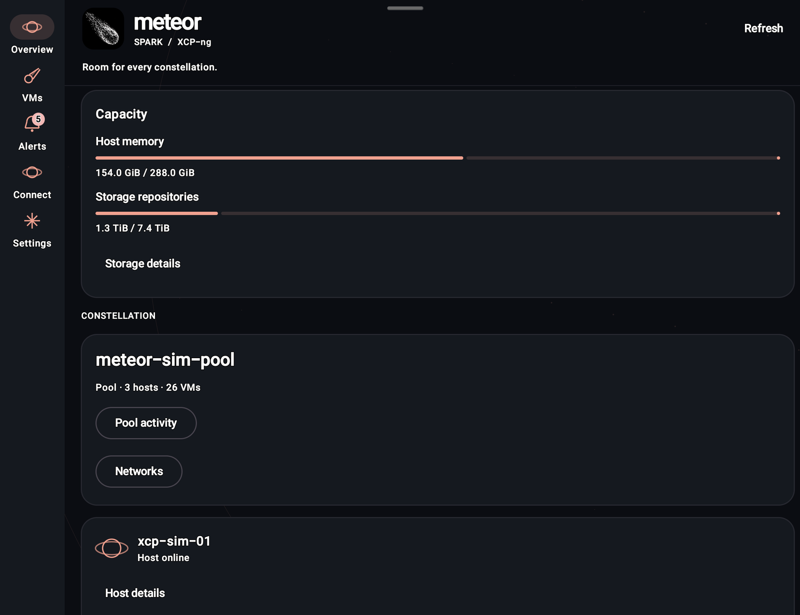
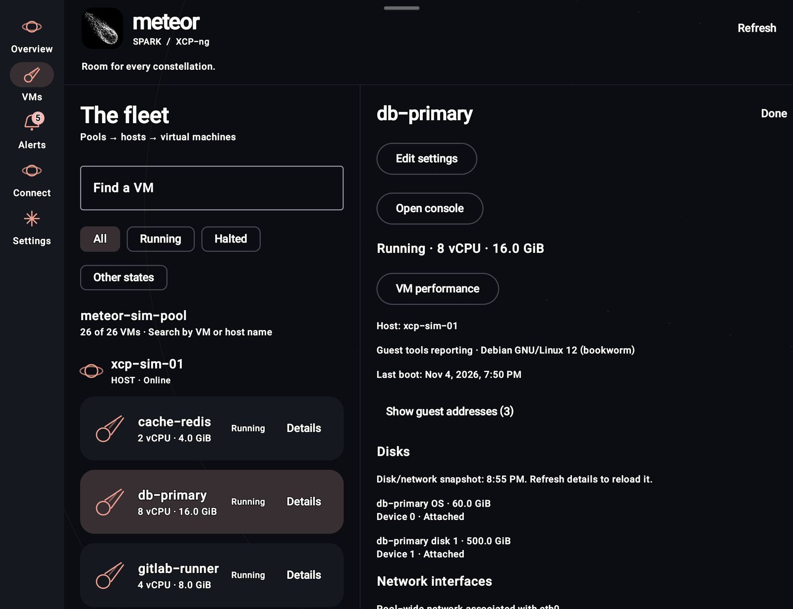
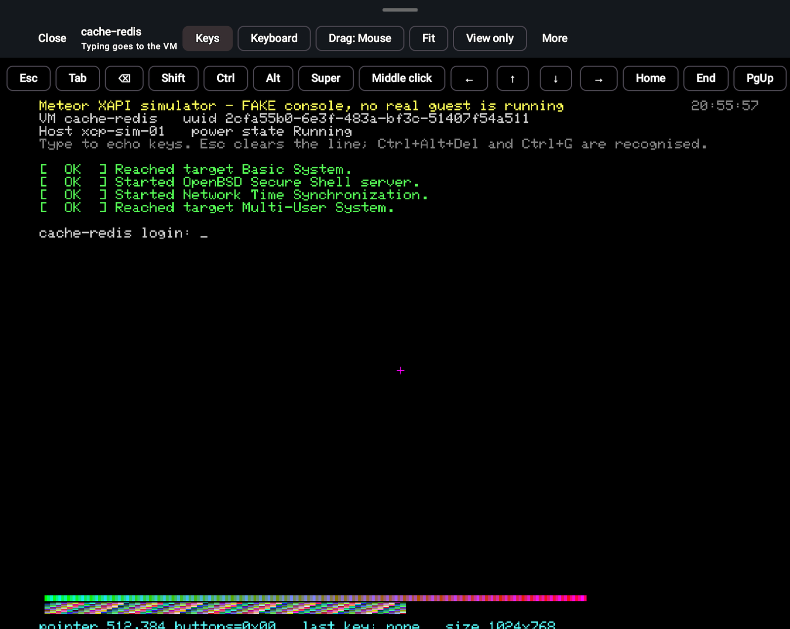
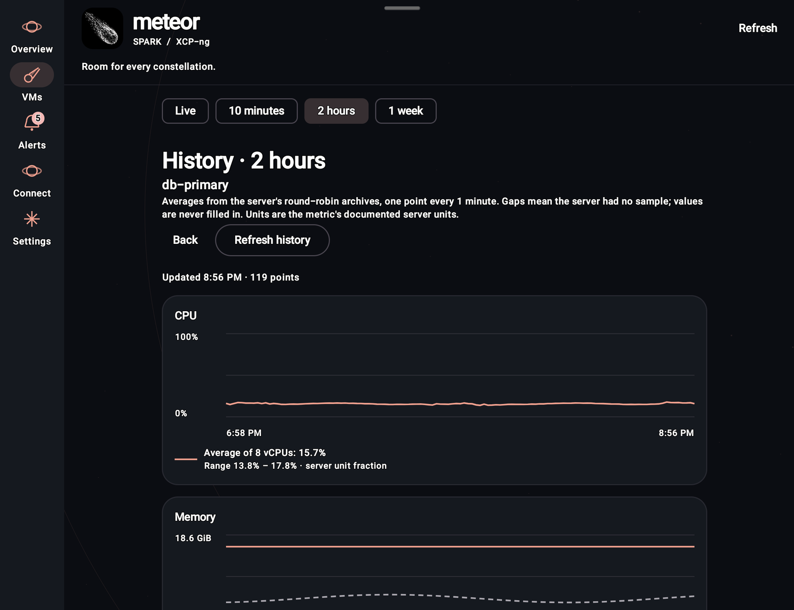

# Meteor

**A native Android client for XCP-ng.** Meteor connects directly to a pool's XAPI over certificate-pinned HTTPS and shows hosts, virtual machines, storage, networks and alerts on your phone. You can run VM, snapshot, host and storage operations, edit a VM's settings, open a VM's or a host's console and follow performance history, and every change goes through a write-ahead journal that never repeats a command it cannot verify.

> **Status:** in active development (1.11). Direct XAPI inventory, VM and host operations, VM settings, snapshots, ISO media, storage repair, the VM and host consoles, performance history, alerts and optional background alert notifications are implemented and covered by offline tests. The parsers and decoders are also tested against recordings of a real XCP-ng 8.3 host, and inventory, the VM console, performance, alerts and a settings edit have been run on a phone against that host. Snapshots, migration, host maintenance, storage repair and input to a host console have not been run against a live server yet. Xen Orchestra connections are planned but not implemented. Meteor is not on an app store; signed APKs, once published, are distributed through [GitHub Releases](https://github.com/primary-null/Meteor/releases) and early builds are marked *Pre-release* there.

<p align="center">
  
</p>

## Screenshots

Taken on a foldable phone's inner display against the project's local XCP-ng simulator, so every pool, host, VM, address and alert shown is made up.

| | |
| --- | --- |
|  |  |
| Overview: capacity, the pool and its hosts | The fleet, with a VM's details beside the list |
|  |  |
| The VM console with the special-key bar (the simulator's stand-in guest screen) | Editing a VM's name, description, tags and resources |
|  |  |
| Performance history from the server's recorded archives | The alerts inbox with priority and kind filters |

## Download and install

**No signed APK has been published yet.** Once the first release is signed and published, its APK will appear on the **[Releases page](https://github.com/primary-null/Meteor/releases)**. Meteor needs Android 12 (API 31) or newer.

1. On your phone, open the [Releases page](https://github.com/primary-null/Meteor/releases) and the newest release.
2. Under **Assets**, download `Meteor-<version>.apk` (for example `Meteor-1.11.apk`). Ignore *Source code (zip)* and *(tar.gz)*: they are not installable. The GitHub Actions run artifacts are build output for developers and need a signed-in GitHub account.
3. Open the downloaded file. When Android asks, allow your browser or file manager to **install unknown apps**, then tap **Install**. You can switch that permission off again afterwards (Settings, Apps, Special app access, Install unknown apps).
4. Open Meteor and follow [Using it](#using-it).

If the install is blocked, check that the permission above is on for the app you opened the file from. On phones where Android's [developer verification](https://developer.android.com/developer-verification/guides) applies, an app from an unregistered developer needs the extra steps Android shows.

**Check the download (recommended).** Each release lists the APK's SHA-256 and the signing certificate's SHA-256 in its notes and attaches `SHA256SUMS.txt`. The signer's fingerprint is also committed in [`release-signer.sha256`](release-signer.sha256).

- `sha256sum -c SHA256SUMS.txt` (Windows PowerShell: `Get-FileHash Meteor-<version>.apk`) must match the checksum.
- `apksigner verify --print-certs Meteor-<version>.apk` (`apksigner` is part of the Android SDK Build-Tools) must report one signer whose *certificate SHA-256 digest* equals that fingerprint.

If either differs, do not install the file.

**Update.** Install the newer APK over the old one. Every release has the application ID `com.meteor.app` and the same signing key, so Android updates it in place and keeps your saved connections, certificate pins and action history. **Do not uninstall first.** Android will not install an older version over a newer one.

If Android reports a conflict with an existing package, the installed copy was signed with a different key, for example a build you made yourself. Uninstalling it removes Meteor's saved connections (they are kept out of backups by design), so note your connection details first. Debug (`com.meteor.app.debug`) and candidate (`com.meteor.app.candidate`) builds use their own IDs and install beside the release.

Maintainers: [docs/RELEASING.md](docs/RELEASING.md).

## Features

- **VM operations.** Start, shut down and reboot (graceful or forced), suspend and resume, pause and unpause, start on a chosen host, and live-migrate within the pool. Each action is offered only when the server allows it, confirms against freshly read state, and disruptive kinds require typing the VM's name. Actions keep a stable position on screen; inapplicable ones are disabled with a reason. A submitted operation is watched for as long as its kind realistically takes, from two minutes to an hour for a host evacuation. The rest of the app stays usable meanwhile, and **Stop watching** leaves the record pending without cancelling or resending anything.
- **VM settings.** Edit a VM's name, description, tags, vCPUs, memory limits, start with the host, boot order and HA restart priority. Each change is offered only in the power state the server accepts it in, shows exactly what will change before sending, and is proven by reading the value back. Lowering vCPUs or memory on a running VM requires typing its name.
- **Snapshots and media.** Take, revert and delete snapshots, and insert or eject ISO images in a VM's virtual CD drive. Snapshot deletion journals each sub-step, so an interrupted delete is never repeated blindly.
- **Host and storage maintenance.** Disable a host for maintenance, evacuate it and enable it again. Host reboot and shutdown are offered only when the host is disabled and runs no VMs. Repair a storage repository whose connections are unplugged. A manual, read-only check shows available host updates.
- **Console.** Tap a running VM to open its full-screen console over the same pinned connection, with compressed encodings, pinch zoom, a special-key bar with hold-to-repeat, keyboard, touch and mouse input, paste as key presses, automatic reconnect after a lost link, and a view-only mode. A host's own console opens from the host's details: it starts view-only every time, asks once before input is sent to the hypervisor, and never offers Ctrl+Alt+Del. Consoles on pool member hosts require their own certificate review.
- **Performance history.** VM and host charts for the last 10 minutes, 2 hours or week from the server's recorded history, plus live readings of CPU, memory, disk and network from a fixed set of enabled sources while the page is visible. Missing or unrecorded sources remain unavailable; declared units and guest-memory semantics are preserved. No recording settings are changed.
- **Alerts.** An inbox of the pool's alerts with an unread badge, readable alarm summaries and confirmed dismissal. It refreshes from server events while the app is open, and follows a pool master change only after you review the new master's certificate.
- **Background alerts (opt-in).** Periodic, read-only alert checks through Android's WorkManager (at most every 15 minutes, only on a network), with notifications and an All pools summary on Overview. Settings shows when each connection was last checked and what happened, alerts are compared in the server's time, and a notification clears when its alert is seen or dismissed in the app. No foreground service.
- **Pool activity.** Inspect the tasks and alerts currently retained by the server, including other clients. Each section handles limited permissions independently. Alert details start collapsed. Progress is an estimate, server task status does not prove a VM power outcome, and the snapshot is not a complete audit log.
- **Operational detail.** Inspect host memory, software version and resident VMs, per-repository storage type and capacity, and a read-only Networks view, from the current pool snapshot.
- **Foldables and tablets.** System Back works throughout. Medium and expanded widths get a navigation rail and side-by-side list and details, and the current screen survives folding and unfolding.
- **Action history.** Browse retained operations in Settings. Verified success, failure, uncertainty and manual closure remain visibly distinct. A slow history reload cannot overwrite newer action state.
- **Find your fleet.** Search by VM or host name, filter by power state, see matching counts, and clear filters in one tap. The inventory reads only real VMs as a stream, so pools of thousands of VMs load, and a list that is shortened says so. The last-known view stays visibly separate from a fresh connection.
- **A quieter header.** Fourteen ambient messages change automatically after 90 seconds on an idle Overview, at most twice per session. No playback controls or continuous rotation.
- **Direct XAPI connection.** Connect to the pool coordinator with no extra server or agent to install. Automatic reconnects back off, stop after rejected credentials or a changed certificate until you act, and an offline phone is shown as offline rather than as a server error.
- **Trust you can review.** Before sending any credentials, Meteor shows the server certificate's SHA-256 fingerprint so you can compare it. Accepting it pins that exact certificate.
- **Manage saved connections.** Rename profiles offline, replace credentials, inspect saved pins, explicitly disconnect, or forget a profile from this device. Certificate review shows validity dates and compares the observed fingerprint with the saved identity. An unresolved action protects its original profile from removal. If the saved connections cannot be opened, Connect explains why and offers a retry or a fresh start that never touches the action history.
- **Fleet overview.** See pool, host, VM and storage capacity at a glance, with VMs grouped by the host they run on (or *Unassigned* when halted).
- **VM details.** View disks, network interfaces, snapshots, the CD drive, guest-tools status, OS and guest addresses (hidden until you ask to see them), last boot time and the operations the server currently allows.
- **Make it yours.** Light, dark or system mode, four accent colours, an optional orbital texture, and a custom icon per VM that stays with the VM's identity as it migrates.

## Architecture highlights

Meteor is a single-activity Kotlin / Jetpack Compose app with a deliberately small dependency surface. Networking, XML-RPC and storage are implemented on platform APIs, with no third-party HTTP or crypto libraries.

### Pinned HTTPS to XAPI

XCP-ng hosts usually serve self-signed certificates, so Meteor replaces CA trust with an explicit, user-approved **leaf certificate pin** (`ServerTrust`, `XapiGateway.kt`):

- Certificate inspection completes a TLS handshake and reads the leaf certificate **without sending credentials**.
- Every later request requires the exact SHA-256 pin, a currently valid certificate and the expected hostname. A changed certificate fails with a distinct `CertificateChanged` error, so the UI can ask you to verify again rather than reporting a generic failure.
- Redirects are refused, responses are capped at 8 MiB (the inventory's VM list is instead parsed as a stream, with its own limits sized from real record costs), and only `https://host[:port]/` endpoints without paths, queries or embedded credentials are accepted. Cleartext traffic is disabled for the whole app.
- The XML-RPC parser (`XmlRpc.kt`) rejects DTDs and entities, limits nesting depth and node count, rejects duplicate struct fields, and turns XAPI failures into error codes without echoing server-supplied arguments.
- Foreground calls share one XAPI session per connected profile (`SessionReuse.kt`), bound to that profile's endpoint, username, password and pin, and logged out on disconnect, on any identity change and after two minutes in the background. A read answered `SESSION_INVALID` logs in once and is repeated once. A write is never repeated, never sent on a kept-alive connection, and not started if its caller was already cancelled. Background checks, the event long-poll and consoles keep their own sessions.

### Encrypted connection profiles

Profiles (endpoint, username, password and pin) are stored in a single **AES-256-GCM** document. The key is generated in and never leaves the **Android Keystore** (`ProfileVault.kt`):

- Versioned file header, random IV per write, authenticated associated data, atomic writes (`AtomicFile`) and size-bounded reads.
- A corrupt or unreadable vault is left untouched. Meteor falls back to session-only connections instead of overwriting the data.
- App data is excluded from cloud backup and device transfer, and `Profile.toString()` redacts credentials.
- Renaming preserves the profile ID, credentials and pin. Leave the password empty when editing to keep it; credential changes use the saved pin. A different server address or renewed certificate requires explicit trust review.
- Disconnect clears the active selection so polling stops and the next launch stays disconnected when that selection can be saved. Forgetting checks the entire operation journal, blocks removal of an unresolved action's original profile and retains closed history. Storage failures preserve existing data and are reported explicitly.

### Journaled operations with safe uncertain-outcome handling

Every state-changing operation (VM power and placement, VM settings, snapshots, CD media, host maintenance and storage repair) is designed around one rule: **a command whose outcome is unknown is never sent again automatically** (`Power.kt`, `VmOperations.kt`, `TargetOperations.kt`, `OperationJournal.kt`).

1. **Confirm against fresh state.** Pressing an action re-reads the VM. The confirmation expires after 30 seconds and is rejected if the connection, pool, VM, power state or boot time changed in the meantime.
2. **Write ahead.** The operation is journaled as `PREPARED`, then `SUBMITTING`, *before* the request leaves the device. A single process-wide lock and a "no unresolved operation" check prevent concurrent or duplicate sends.
3. **Track the server task.** The returned task reference and UUID are journaled as soon as they arrive. If a disk write fails, the ticket is kept in memory so a later status check can still persist it.
4. **Verify by read-back.** Task success alone is not enough. Meteor re-reads the target and requires the expected result: the expected power state, the VM on the chosen host, the new snapshot present, the host disabled. A reboot also requires a *changed*, valid boot timestamp.
5. **Classify failures honestly.** An explicit XAPI rejection before a task exists is a definite failure. A lost response, timeout or crash after sending is recorded as `UNKNOWN`. The one retry is for calls whose signature differs between XAPI versions: only an explicit `MESSAGE_PARAMETER_COUNT_MISMATCH`, which proves the call never ran, permits sending it once with the other signature.
6. **Recover by observing only.** *Check status* re-reads the original pool and VM through the original trusted connection and resumes watching the saved task. Recovery code has no path to `submit`.
7. **Manual review as a last resort.** If the task can't be found, you can review the record. Meteor reads the original VM again, refuses while any VM operation is active, asks you to confirm that you checked the server's task history, and re-reads once more before closing. The closed record keeps the original action and its **unverified** outcome. It is never reported as a success.

VM settings use synchronous calls that return no task, so each setter is its own journaled step: the value is read just before sending, the single call is sent, and success is the requested value read back (`VmSettings.kt`). A lost reply is never resent. Only error codes the server raises before it writes anything count as a definite rejection; everything else is decided by the read-back.

While an operation is unresolved, new operations stay locked, but connections can still be repaired or added so you can investigate. A record whose VM was deleted on the server, or that an older build cannot interpret, can be closed after manual review instead of locking the app. Journal and profile documents remain version 1 and only gained optional keys, so data from earlier releases loads unchanged; an older build that meets an operation kind it does not know keeps it locked instead of discarding it.

### Responsive and race-safe UI

- Connection forms account for the software keyboard, keep lower fields and buttons reachable, and dismiss it when a form is submitted or cancelled.
- Typed destinations and a back stack (`Navigation.kt`) drive system Back. Width classes choose between the phone layout and a navigation rail with list-detail panes (`Adaptive.kt`).
- Background inventory refreshes keep the connection, open details and pending confirmations in place, and are fenced like every other request.
- `MeteorViewModel` uses generation counters to discard stale inventory and detail responses. When you switch connections or VMs quickly, the latest request wins, and a detail response from another connection is never shown, even if both point at the same pool.
- The UI refreshes inventory and open VM details only while the app is visible (`repeatOnLifecycle`).
- Automatic detail polling reuses display-only disk/network topology for up to 60 seconds. Power, boot time, allowed operations and active operations are always read anew. Explicit refresh and every power confirmation/verification read bypass this reuse.
- Connection coordination and certificate inspection are independently testable on the JVM. Informational notices, warnings and errors have separate presentation.

### Read-only observability

`ObservabilityController` fences requests by profile, connection origin, pool, object and generation. Switching connection/pool or disconnecting clears observations; read failures mark displayed data as last known. `MetricWindow` bounds memory, preserves gaps and resets on clock rollback or target change. The active page polls only while the app is visible.

The gateway uses XAPI's [VM](https://xapi-project.github.io/xen-api/classes/vm.html) and [host](https://xapi-project.github.io/xen-api/classes/host.html) `get_data_sources` as a catalogue and `query_data_source` for current values (a real server reports no values in the catalogue), plus read-only [task](https://xapi-project.github.io/xen-api/classes/task.html) and [message](https://xapi-project.github.io/xen-api/classes/message.html) snapshots through the same pinned HTTPS sessions. History comes from `/rrd_updates` (XML or JSON) through `PinnedHttp`, which applies the same pin, hostname, redirect and size rules as XML-RPC. That URL carries a session reference, so errors never include it. Task results, backtraces and error arguments are excluded, and no task cancellation is offered. Alert refresh uses `event.from` on a separate foreground session, and dismissal is confirmed by reading the alert back.

### Executable reference model

`meteor_logic/` is a dependency-free Python reference model of the core safety rules: connection-generation fencing, capability gates, confirmation plans, a SQLite journal, duplicate-action exclusion and read-back verification. It predates the Android implementation and is useful for exploring edge cases; Android-specific reboot, encrypted-storage and manual-recovery behavior is covered by the Kotlin tests. The model covers both the direct-XAPI and planned Xen Orchestra provider shapes, but contains no network code.

More detail is in [docs/ARCHITECTURE.md](docs/ARCHITECTURE.md).

## Tech stack

Kotlin · Jetpack Compose (Material 3) · Kotlin coroutines & Flow · AndroidX Lifecycle / ViewModel · DataStore · WorkManager · Android Keystore · `HttpsURLConnection` + XmlPullParser · JUnit 4 · Python 3.11+ (reference model and repository checks) · GitHub Actions

Minimum Android 12 (API 31), target API 36.

## Repository layout

```
android-app/                Gradle project (single :app module)
  app/src/main/…/data/      Transport, XML-RPC, trust, vault, journal, power engine
  app/src/main/…/           Compose UI and ViewModel
  app/src/test/             JVM unit tests, a real loopback HTTPS/XAPI fixture, sanitized recordings of a real XCP-ng 8.3 host
  app/src/androidTest/      Offline instrumentation tests (vault, journal, UI journeys, races)
meteor_logic/               Python reference model and its tests
scripts/                    Repository checks: source guard, version helper and release signing/verification
design/                     Interactive HTML design studies
docs/                       Architecture notes and the release guide
```

## Build and test

Requirements: **JDK 21**, the **Android SDK with platform 36.1**, and **Python 3.11+**. Point Gradle at the SDK with `ANDROID_HOME` or an untracked `android-app/local.properties` (`sdk.dir=…`).

```sh
cd android-app
./gradlew :app:assembleDebug :app:testDebugUnitTest :app:lintDebug   # gradlew.bat on Windows
```

From the repository root:

```sh
python scripts/source_guard.py                         # blocks private-key headers, GitHub tokens, credential/keystore files and build artefacts
python -m unittest discover -s scripts -p "test_*.py"  # safety and release-script tests (signing tests need the SDK build-tools and a JDK)
python -m unittest meteor_logic.test_core              # reference-model tests
```

The JVM unit tests need no device or network. The transport tests start a local HTTPS server with a temporary self-signed certificate. CI ([`.github/workflows/validate.yml`](.github/workflows/validate.yml)) runs all of the above on Ubuntu and needs no secrets.

`./gradlew :app:assembleRelease` produces an **unsigned** APK, which Android will not install. Signed releases come from the [Release workflow](.github/workflows/release.yml), which builds on GitHub's runners and signs outside Gradle with a pinned key; see [docs/RELEASING.md](docs/RELEASING.md).

Instrumentation tests in `app/src/androidTest` run offline with synthetic storage against a release-like build type (`candidate`, application ID `com.meteor.app.candidate`) that installs alongside a debug build. Some tests deliberately corrupt their own files, so run them on an emulator:

```sh
./gradlew -PmeteorTestBuildType=candidate :app:assembleCandidate :app:connectedCandidateAndroidTest
```

## Using it

1. Open **Connect**, enter a name, the pool coordinator's address (for example `https://xcp-pool.example`), a username and a password.
2. Tap **Review certificate** and compare the fingerprint with the one shown on the host's console or from a trusted source.
3. Tap **Trust and connect**. The profile is saved encrypted only after a successful connection.

Meteor is meant for private networks or a VPN. It does not expose any listening service.

## Roadmap

- Live-server acceptance of snapshots, migration, host maintenance and storage repair on XCP-ng 8.3
- Day-to-day parity with XCP-ng's own tools: create, clone and delete VMs, disks and network interfaces, then host, storage, network and pool administration
- Fleet sorting and wider search, a problems-first overview and user-defined alert thresholds
- Xen Orchestra (REST) connections alongside direct XAPI, for backups, restore and replication
- Store packaging beyond GitHub Releases

## License

Released under the [MIT License](LICENSE).
