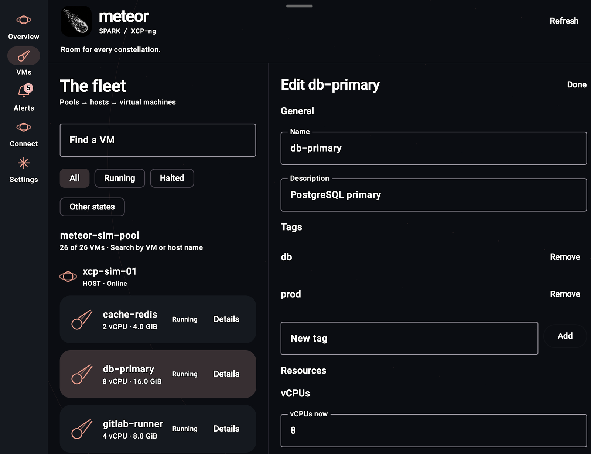
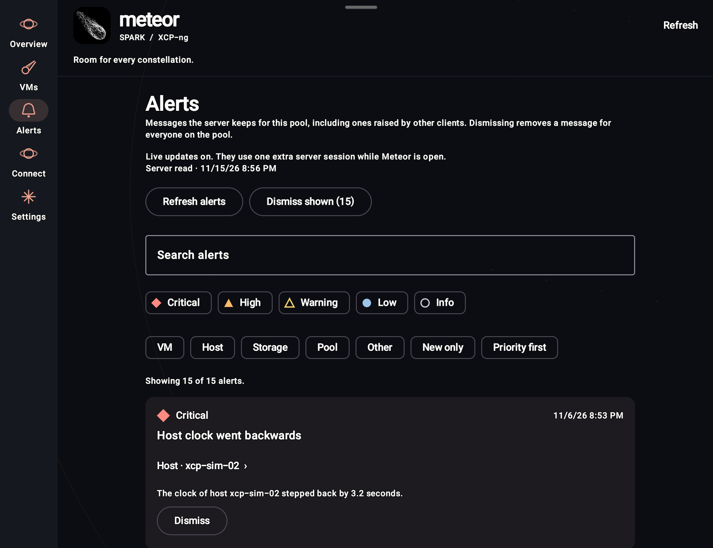

# Meteor

**A native Android client for XCP-ng.** Meteor connects straight to a pool over certificate-pinned HTTPS, so you can watch and run your hosts and virtual machines from a phone, foldable or tablet. No extra server, agent or account.

<p align="center">
  
</p>

> **Status: in development (1.11).** Built for XCP-ng 8.3. Inventory, the console, performance, alerts and settings editing have been run against a real host; snapshots, migration and host maintenance are tested offline only so far. No signed APK is published yet, so for now you build it yourself.

## Screenshots

| | |
| --- | --- |
|  |  |
|  |  |
|  |  |

Taken on a foldable against a local simulator: every name and alert shown is made up.

## What it does

- **See the pool.** Hosts, VMs, storage, networks and capacity, grouped by host, with search and power-state filters. Pools with thousands of VMs load.
- **Run VMs.** Start, shut down, reboot, suspend, pause, migrate, or start on a chosen host.
- **Edit VMs.** Name, description, tags, vCPUs, memory, boot order and start with the host.
- **Console.** Tap a running VM for a full-screen console with a special-key bar, keyboard, touch and mouse. A host's own console opens view-only.
- **Snapshots and media.** Take, revert and delete snapshots; insert and eject ISO images.
- **Host and storage maintenance.** Disable, evacuate, enable, reboot or shut down a host; repair an unplugged storage repository.
- **Performance.** Live CPU, memory, disk and network, and charts for the last 10 minutes, 2 hours or week.
- **Alerts.** An inbox of the pool's alerts with filters, and optional background checks that notify you.
- **Any screen size.** A navigation rail and side-by-side panes on foldables and tablets.

The full list is in [docs/FEATURES.md](docs/FEATURES.md).

## How it stays safe

- **You approve the certificate.** Meteor shows the server's fingerprint before any password is sent, then accepts only that exact certificate.
- **Saved connections are encrypted** with a key held in the Android Keystore, and kept out of backups.
- **No blind retries.** Every change is written to a journal before it is sent and proven by reading the result back. If the outcome is unknown, Meteor never sends the command again by itself.

How this works is described in [docs/ARCHITECTURE.md](docs/ARCHITECTURE.md).

## Install

No signed APK has been published yet. When one is, it will appear on the [Releases page](https://github.com/primary-null/Meteor/releases). Meteor needs Android 12 or newer. Install, verification and first-connection steps are in [docs/INSTALL.md](docs/INSTALL.md).

## Build and test

You need JDK 21, the Android SDK with platform 36.1, and Python 3.11 or newer.

```sh
cd android-app
./gradlew :app:assembleDebug :app:testDebugUnitTest :app:lintDebug   # gradlew.bat on Windows
```

```sh
python scripts/source_guard.py
python -m unittest discover -s scripts -p "test_*.py"
python -m unittest meteor_logic.test_core
```

The unit tests need no device or network. More detail, the repository layout and the release process are in [docs/ARCHITECTURE.md](docs/ARCHITECTURE.md) and [docs/RELEASING.md](docs/RELEASING.md).

## Roadmap

- Create, clone and delete VMs, disks and network interfaces
- Host, storage, network and pool administration
- Fleet sorting, wider search and alert thresholds
- Xen Orchestra connections, for backups and restore

## License

[MIT](LICENSE).
